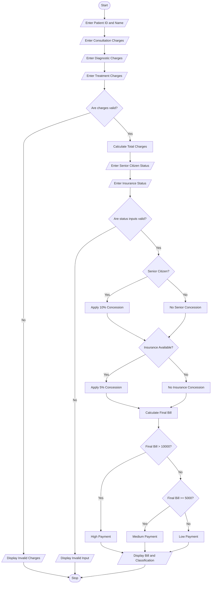

# Problem Statement
Design a Hospital Billing and Patient Classification System to calculate the total hospital bill based on consultation charges, diagnostic charges, and treatment charges. Apply conditional concessions based on patient eligibility, validate billing constraints, and classify patients according to a given payment policy.
# Assumptions
1. Every patient has a unique Patient ID.
2. Consultation, diagnostic, and treatment charges must be non-negative.
3. A 10% concession is given to senior citizens.
4. A 5% concession is given to patients with valid insurance.
5. The maximum concession is 15%.
6. If the total bill is above ₹10,000, the patient is classified as a High-Payment patient.
7. If the total bill is between ₹5,000 and ₹10,000, the patient is classified as a Medium-Payment patient.
8. If the total bill is below ₹5,000, the patient is classified as a Low-Payment patient.
# mermaid flow chart

# sample input
#Enter Patient ID: 101
Enter Patient Name: Bhavya
Consultation Charges: 1000
Diagnostic Charges: 2000
Treatment Charges: 8000
Senior Citizen (1-Yes, 0-No): 1
Insurance Available (1-Yes, 0-No): 1 Algorithm
1. Start.
2. Read patient ID and patient name.
3. Read consultation charges.
4. Read diagnostic charges.
5. Read treatment charges.
6. Validate that all charges are non-negative.
7. Calculate the subtotal.
8. Check whether the patient is a senior citizen.
9. Apply a 10% concession if eligible.
10. Check insurance eligibility and apply a 5% concession.
11. Calculate the final bill after concessions.
12. Classify the patient based on the final bill.
13. Display patient details, total bill, concession, and patient category.
14. Stop.
