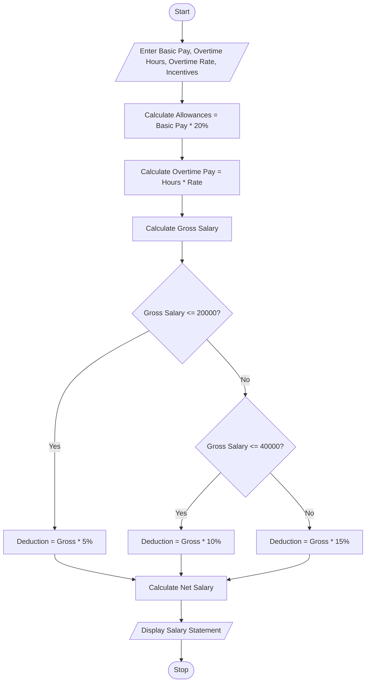

# Problem Statement
Develop a program to calculate an employee's salary based on basic pay, allowances, overtime, and incentives. Calculate the gross salary and apply progressive deductions based on salary slabs. Finally, calculate the net salary and display a formatted salary statement.
# Assumptions
1. Basic pay is entered by the user.
2. Allowances are calculated as 20% of basic pay.
3. Overtime pay is calculated based on overtime hours.
4. Incentives are entered by the user.
5. Progressive deductions are applied as follows:
Gross Salary	Deduction
Up to ₹20,000	5%
₹20,001 – ₹40,000	10%
Above ₹40,000	15%
6. Gross Salary = Basic Pay + Allowances + Overtime + Incentives.
7. Net Salary = Gross Salary − Deduction.
# Algorithm
1. Start.
2. Read basic pay, overtime hours, overtime rate, and incentives.
3. Calculate allowances = Basic Pay × 20 / 100.
4. Calculate overtime pay = Overtime Hours × Overtime Rate.
5. Calculate gross salary.
6. Check gross salary:
   - If gross salary is less than or equal to 20,000, deduction = 5%.
   - If gross salary is between 20,001 and 40,000, deduction = 10%.
   - Otherwise, deduction = 15%.
7. Calculate net salary = Gross Salary − Deduction.
8. Display the salary statement.
9. Stop.
# mermaid flow chat

# sample input

----- SALARY STATEMENT -----

Basic Pay       = 25000.00
Allowances      = 5000.00
Overtime Pay    = 1000.00
Incentives      = 2000.00
Gross Salary    = 33000.00
Deduction       = 3300.00
Net Salary      = 29700.00
