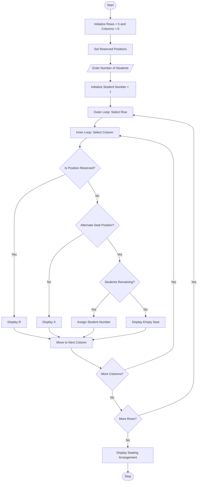

#  Problem Statement
Develop a Python program using nested loops to generate an examination seating arrangement based on classroom rows and columns. The system should assign row and column identifiers, mark reserved positions, follow alternate seating restrictions, and maintain fixed classroom capacity. Finally, display the complete seating arrangement.
# Assumptions
1. Classroom has 5 rows and 6 columns.
2. Total classroom capacity is 30 seats.
3. Each seat has a unique row and column identifier.
4. Reserved positions are not assigned to students.
5. Alternate seating restriction is followed by leaving one seat empty between students in each row.
6. Reserved seats are marked as R.
7. Empty seats are marked as X.
8. Available seats are marked with student numbers.
9. Students are assigned row by row from left to right.
# Algorithm
1. Start.
2. Initialize the number of rows and columns.
3. Calculate total classroom capacity.
4. Read the number of students.
5. Define reserved seat positions.
6. Use an outer loop to iterate through rows.
7. Use an inner loop to iterate through columns.
8. Check whether the position is reserved.
9. If reserved, display R.
10. Otherwise, check alternate seating restrictions.
11. If the position is restricted, display X.
12. Otherwise, assign the next student number.
13. Repeat until
# mermaid flow chart

# sample input

Enter number of students: 10
