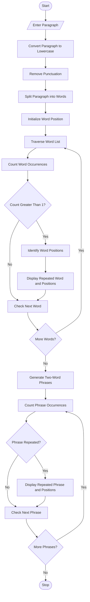

# Problem Statement
Develop a Python program to process a paragraph and identify repeated words and phrases. The program should normalize letter case, count the occurrences of each word using string and list operations, and display repeated words along with their positions in the paragraph.
# Assumptions
1. The paragraph is entered by the user.
2. Uppercase and lowercase letters are treated equally.
3. Punctuation marks are removed before word counting.
4. Words are separated using spaces.
5. Word positions start from 1.
6. A word is considered repeated if it occurs more than once.
7. A phrase is considered repeated if the same consecutive two-word combination occurs more than once.
8. Display the word, occurrence count, and positions.
# Algorithm
1. Start.
2. Read a paragraph from the user.
3. Convert the paragraph into lowercase.
4. Remove punctuation marks.
5. Split the paragraph into individual words.
6. Create an empty list to store repeated words.
# mermaid flow chart

# sample input
Enter a paragraph:
Python is easy and Python is powerful.
Learning Python is easy and learning Python is fun.
