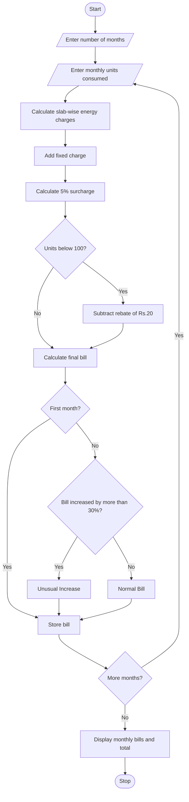

# Problem Statement
Develop a Progressive Electricity Billing System to calculate household electricity bills based on monthly power consumption. The system uses multiple consumption slabs, fixed charges, surcharges, and rebates to calculate the final bill. It also compares electricity bills across several months and identifies unusual increases in consumption and billing amounts.
# Assumptions
1. Electricity consumption is measured in units (kWh).
2. The billing is calculated using the following slabs:
Consumption	Rate per unit
First 100 units	₹2
Next 100 units	₹3
Next 100 units	₹5
Above 300 units	₹7

3. Fixed charge is ₹50 per month.
4. Surcharge is 5% of the energy charge.
5. A rebate of ₹20 is given if consumption is below 100 units.
6. An increase of more than 30% compared with the previous month's bill is considered unusual.
7. Bills are calculated for 4 months.
# Algorithm
1. Start.
2. Enter the number of months.
3. Read electricity consumption for each month.
4. Calculate energy charges using progressive slabs.
5. Add fixed charges.
6. Calculate a 5% surcharge on energy charges.
7. If consumption is below 100 units, subtract a rebate of ₹20.
8. Calculate the final electricity bill.
9. Compare the current month's bill with the previous month's bill.
10. If the increase is more than 30%, display "Unusual Increase".
11. Otherwise, display "Normal Bill".
12. Display monthly bills and total bill.
13. Stop.
# mermaid flow chart

# sample input
Enter number of months: 4

Month 1 consumption: 80 units
Month 2 consumption: 120 units
Month 3 consumption: 180 units
Month 4 consumption: 280 units
